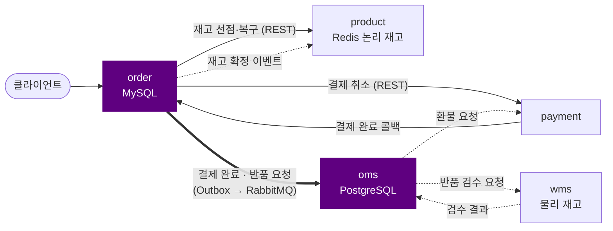
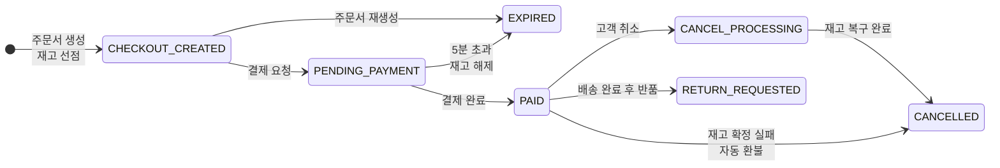
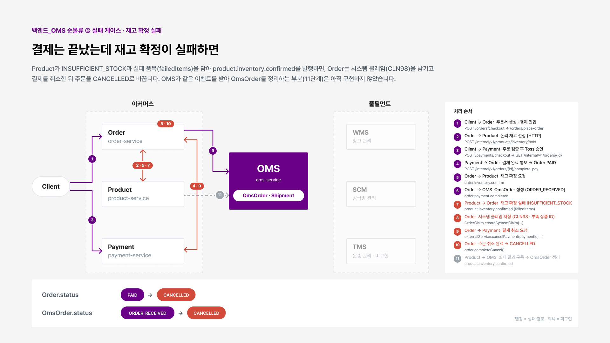
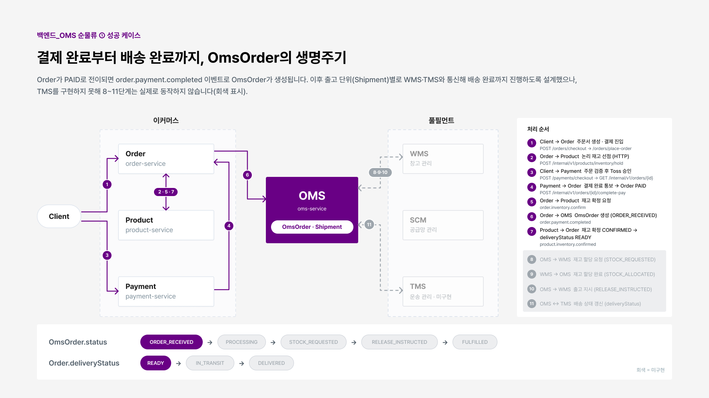
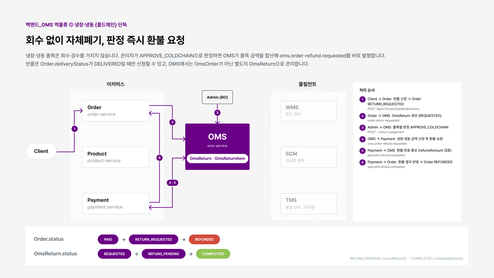
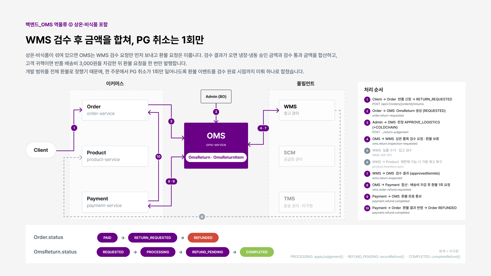

# 신선식품 새벽배송 커머스의 주문·풀필먼트 백엔드, Kurly Clone

> 결제 이후 출고·반품까지 이어지는 8개 서비스 MSA

| 항목 | 내용 |
|---|---|
| 기간 | 2026.08 ~ 2026.10 (8주) |
| 유형 | 팀 프로젝트 (kt cloud TECH UP 통합 프로젝트, 우수상) |
| 인원 | 20명 (7개 과정 협업 · 백엔드 3) |
| 담당 | 백엔드 팀장 → 개발 일정 팀장, 주문 서비스(order-service) · OMS(oms-service) 설계·구현 |
| 링크 | [원본 레포](https://github.com/5issue/total-backend) · [팀 개발 문서](docs/team-project.md) |

## 프로젝트 개요

### 배경
신선식품을 새벽배송하는 커머스는 결제가 끝난 뒤에도 물류센터 처리 용량, 유통기한, 상품 온도대에 따라 출고와 반품 방식이 달라집니다. 마켓컬리를 참고해 이커머스와 풀필먼트를 7개 팀이 하나의 서비스로 만드는 프로젝트를 진행했습니다. 저는 주문과 OMS를 맡아, 실제 신선식품 커머스의 재고·취소·반품 정책을 조사하고 서비스 규칙으로 옮겼습니다.

### 목표
- 장바구니부터 결제, 취소·반품까지 주문 생명주기 구현
- 결제 완료 주문을 풀필먼트(OMS → WMS)로 유실·중복 없이 전달
- 논리 재고·물리 재고 분리, 온도대별 반품 정책을 서비스 간 책임과 상태 전이로 설계

## 기술 스택

| 분류 | 기술 |
|---|---|
| Backend | Java 25, Spring Boot 4.1.0, Spring Data JPA, Spring Modulith Events, Flyway |
| Database | MySQL 8.4 (주문), PostgreSQL 17 (OMS) |
| Messaging · Cache | RabbitMQ, Redis |
| Test | JUnit 5, Testcontainers |
| Infra / DevOps | Docker, Kubernetes (EKS), Argo CD, GitHub Actions |

---

## 프로젝트 소개

### 주요 기능

| 기능 | 서비스 | 설명 | 담당 |
|:---|:---|:---|:---|
| **주문** | order | 장바구니, 주문서 생성·재고 선점, 결제 요청, 취소·반품 | 손하영 ([@glosona](https://github.com/glosona)) |
| **OMS** | oms | 결제 완료 주문 접수, 반품 판정·역물류, 배송 약속 조회 | 손하영 ([@glosona](https://github.com/glosona)) |
| **인증·회원** | auth, user | 소셜 로그인, ES256 JWT·KMS 서명, 세션, 배송지 | 김재우 ([@J4E-mik](https://github.com/J4E-mik)) |
| **결제** | payment | PG 승인·취소, 환불 이벤트 | 김재우 ([@J4E-mik](https://github.com/J4E-mik)) |
| **상품·재고** | product | 상품·검색, Redis 논리 재고 선점·확정·복구 | 신지훈 ([@jihoon0413](https://github.com/jihoon0413)) |
| **WMS** | wms | 입고 검수·적치, FEFO 재고 할당, 피킹·출고 | 신지훈 ([@jihoon0413](https://github.com/jihoon0413)) |
| **배포** | 전체 | 서비스별 CI/CD, ECR, Argo CD 자동 배포 | [@parkyhun](https://github.com/parkyhun) |

### 시스템 구조



- 보라색이 담당 서비스. 실선은 동기 REST, 굵은 선과 점선은 RabbitMQ 이벤트
- 게이트웨이 없이 각 서비스가 JWT를 직접 검증하고, 서비스 간 내부 API는 `/internal/v1/**`로 분리

> 공통 모듈, 인증·인가 규격, 포트 규칙, 배포 파이프라인 등 팀 개발 문서는 [docs/team-project.md](docs/team-project.md)에 정리

---

## 담당: 주문·OMS 구현

주문서 생성부터 결제 완료 후 OMS 이관, 취소·반품·환불 요청까지 주문 쪽 흐름 전체

| 담당 | 내용 |
|---|---|
| 주문 생명주기 | 장바구니 → 주문서 생성 → 결제 요청 → 결제 완료 → 취소·반품, 결제 대기 5분 초과 주문 자동 만료 |
| 재고 연동 | 주문서 생성 시 상품 서비스에 재고 선점 요청, 결제 완료 후 확정 이벤트, 결과에 따라 배송 준비 또는 자동 취소·환불 |
| 이벤트 발행 | Spring Modulith `event_publication` 기반 Outbox, 7일 지난 발행 완료 이벤트 정리 |
| OMS 주문 접수 | 결제 완료 이벤트 수신, `source_event_id`·`order_id` UNIQUE 기반 중복 접수 차단 |
| 반품 판정·역물류 | 품목별 판정(콜드체인 자체 폐기 / 회수 / 거절), WMS 검수 결과 반영, 귀책별 배송비 차감 후 환불 요청 |
| 배송 약속 | 주소 → 배송 권역(TAM) → 배송 회차로 주문 마감 시각·도착 예정 시각 계산 |
| 테스트 | 단위 테스트, Testcontainers(MySQL) 기반 주문-결제 통합 테스트 (주문 38개 · OMS 51개) |

### 주문 상태 흐름



- 상태를 바꾸는 요청은 주문 행을 `SELECT … FOR UPDATE`로 잠근 뒤 현재 상태를 검사해, 결제 완료 콜백과 취소 요청이 겹쳐도 한쪽만 반영
- 재고 복구·확정 결과 이벤트는 이미 처리된 상태면 성공으로 넘겨, 같은 이벤트를 다시 받아도 결과가 같음

---

## 풀필먼트 도메인 조사와 설계 반영

이커머스 주문은 결제 완료로 끝나지만, 신선식품 커머스는 그 뒤에 물류 단계가 이어집니다. 주문 서비스를 설계하기 전에 실제 신선식품 커머스의 재고·취소·반품 정책을 조사하고, 그 결과를 서비스 간 책임과 상태 전이로 옮겼습니다.

### 1. 논리 재고와 물리 재고 분리

> 판매 가능 수량(논리 재고)과 창고의 실물(물리 재고)을 서로 다른 서비스가 관리

**조사 내용**

- 주문서 진입 시 논리 재고를 TTL을 두고 선점해 결제 중 품절(overselling)을 막고, 실물은 결제 후 WMS가 유통기한(FEFO) 기준 로트·로케이션으로 할당
- 재고가 있어도 물류센터의 회차별 처리 용량(CAPA)이 없으면 당일 출고 불가. 처리 순서는 `논리 재고 확보 → 결제 승인 → CAPA 승인 → 물리 재고 할당`
- 결제 후 피킹 단계의 변질·파손, 유통기한 미달로 생기는 사후 결품은 정상적인 예외 케이스

**설계 반영**

| 처리 | 책임 서비스 | 반영 내용 |
|---|---|---|
| 논리 재고 선점·확정·복구 | 상품 | 수량 관리와 동시성 제어를 상품 서비스로 일원화, 선점 유효 시간 15분 |
| 선점 요청·식별자 보관 | 주문 | 주문은 재고를 직접 차감하지 않고 예약 토큰(UUID)과 만료 시각만 보관 |
| 결제 완료 주문 이관 | 주문 → OMS | Outbox로 결제 완료 이벤트 발행 |
| 물리 재고 할당 | OMS → WMS | 결제 완료 이후 OMS가 요청 |
| 사후 결품 | 주문 | 재고 확정 실패 이벤트 수신 시 시스템 클레임 생성 후 결제 전액 취소 |



<sub>*결제 완료 후 재고 확정 실패 흐름. 빨간 선은 실패 경로, 회색은 미구현(OMS 쪽 OmsOrder 정리)*</sub>

- 물리 재고를 WMS가 맡는 구조는 WMS 담당 팀원 제안. 주문·OMS 쪽 책임 범위와 선점(hold)·확정(confirm)·복구(release) 연동 원칙은 직접 정리해 팀 기준 문서로 공유
- 재고 수량을 주문과 상품이 나눠 가지면 두 저장소의 수량을 맞추는 복구 로직이 필요해져, 주문 쪽에는 토큰만 두는 방식으로 정리

### 2. 결제 이후의 흐름은 OMS가 소유

> 주문 서비스는 "결제 완료"까지, 출고·반품 판정은 OMS가 담당



<sub>*결제 완료 이후 정상 흐름. 번호는 처리 순서, 회색은 미구현(TMS 연동 8~11단계)*</sub>

- 조사 결과 결제 이후 단계(권역 매핑, 온도대별 Shipment 분할, CAPA 검증, 출고 지시)는 주문 정보보다 물류센터·권역·회차 데이터에 의존해, 이 데이터를 가진 OMS로 분리
- 주문 서비스는 결제 완료 시 주문 상품·배송지 스냅샷을 이벤트로 넘기고, OMS는 이를 자체 주문(`oms_orders`)으로 접수
- 이벤트는 최소 한 번 전달되므로 OMS는 `source_event_id`·`order_id` UNIQUE 제약으로 중복을 막고, 동시에 들어온 중복은 제약 위반 예외의 제약 이름으로 구분해 정상 처리

```java
// OmsOrderService: 동시 접수 중복은 무시, 그 외 무결성 오류는 그대로 전파
try {
    orderCreator.create(omsOrder);   // REQUIRES_NEW
} catch (DataIntegrityViolationException e) {
    if (!isDuplicateOrderConstraint(e) || (
            !omsOrderRepository.existsBySourceEventId(eventId) &&
            !omsOrderRepository.existsByOrderId(orderId))) {
        throw e;
    }
    log.info("동시 주문 생성 중복 eventId={}, orderId={}", eventId, orderId);
}
```

### 3. 취소 가능 시점은 출고 작업 시작 전까지

> 주문 상태만으로는 알 수 없어, 취소 직전 OMS에 동기 조회

- 조사 결과 피킹·패킹이 시작되면 고객 취소 버튼이 비활성화되고 반품으로 전환
- 출고 진행 여부는 OMS가 알고 있어, 주문 서비스는 취소 요청 시 OMS의 취소 가능 여부 API(`GET /internal/v1/oms/orders/{orderId}/cancel-eligibility`)를 호출한 뒤에만 취소 진행
- 취소가 승인되면 결제 취소 요청과 재고 복구 이벤트를 발행하고, 재고 복구 완료 이벤트를 받은 뒤 `CANCELLED`로 전이

### 4. 온도대별 반품 정책

> 냉장·냉동 하자품은 회수하지 않고 자체 폐기 후 환불, 상온은 회수·검수 후 환불

**조사 내용**

| 구분 | 단순 변심 | 하자 신청 기한 | 실물 회수 |
|---|---|---|---|
| 냉장 / 냉동 | 불가 (재판매 불가) | 수령 후 48시간 | 미회수 (자체 폐기) |
| 상온 | 7일 이내 (배송비 고객 부담) | 수령 후 3개월 | 회수 후 검수 |

**설계 반영**

- 주문 서비스: 냉장·냉동 상품이 섞인 주문은 단순 변심 반품을 막고, 반품 기한을 온도대·사유별로 계산. 증빙이 필요한 사유는 사진 첨부 필수
- OMS: 관리자가 품목별로 `APPROVE_COLDCHAIN`(자체 폐기) / `APPROVE_LOGISTICS`(회수) / `REJECT` 판정
  - 상온 상품에 `APPROVE_COLDCHAIN` 판정 시 거부
  - 회수 품목이 있으면 WMS 검수 요청만 발행하고, 환불은 검수 결과를 받은 뒤 자체 폐기 품목 금액과 합쳐 한 번에 요청
  - 자체 폐기 품목만 있으면 즉시 환불 요청
  - 검수 결과 고객 귀책이면 반품 배송비 차감

| 주문 구성 | 판정 후 처리 | 환불 시점 |
|---|---|---|
| 냉장·냉동만 | 즉시 환불 요청 | 판정 직후 |
| 상온 포함 | WMS 검수 요청 | 검수 결과 수신 후 통합 환불 |
| 상온 검수 전량 불합격 | 자체 폐기 품목만 환불 | 검수 결과 수신 후 |

- 개발 범위를 전체 환불로 정해, 한 주문에서 PG 취소가 1회만 일어나도록 상온 품목이 있으면 환불 요청을 검수 완료 시점까지 미뤄 하나로 합침

| 냉장·냉동만 | 상온 포함 |
|---|---|
|  |  |

<sub>*왼쪽은 회수 없이 판정 즉시 환불, 오른쪽은 WMS 검수 후 통합 환불. 아래 줄은 Order·OmsReturn 상태 전이*</sub>

---

## 기술 선택 과정

주문과 OMS의 워크로드가 달라 DB를 따로 비교했고, 서비스 간 이벤트 발행 방식을 함께 정했습니다. 인프라 예산이 50만 원으로 정해져 있어, 기능이 비슷하면 추가 Pod가 필요 없는 쪽을 우선했습니다.

| 대상 | 후보 | 선택 | 이유 |
|---|---|---|---|
| 주문 DB | MySQL 8.4 / PostgreSQL 18 / MongoDB 8.0 | **MySQL 8.4** | 주문 1건당 상태 UPDATE 5~7회, InnoDB in-place UPDATE로 테이블 팽창 없음. 주문-재고 예약 원자성은 RDB 제약으로 강제 |
| OMS DB | PostgreSQL 18 / MySQL 8.4 | **PostgreSQL** | 주문-Shipment-센터-권역 다중 조인, 권역 판정용 PostGIS, 트랜잭션 종료 시 자동 반납되는 advisory lock 필요 |
| 이벤트 발행 | Spring Modulith / Debezium CDC / Scheduler 직접 구현 | **Spring Modulith** | 커밋과 함께 `event_publication`에 기록, 발행 실패 건은 미완료로 남아 재발행 대상이 됨. Debezium은 별도 Pod(512MB~1GB)가 필요해 예산 제약으로 제외. MySQL·PostgreSQL 양쪽에 같은 방식 적용 |
| 메시지 브로커 | Kafka / RabbitMQ / Redis Streams | **RabbitMQ** | 이벤트 재처리(Replay)만 보면 Kafka가 적합했으나, 브로커 최소 3 Pod(3~6GB RAM)가 필요해 예산 안에서 운영이 어려워 RabbitMQ로 확정 |
| 동시성 제어 | Redis 분산 락 / DB 락 | **DB 락·UNIQUE** | 주문 상태 변경은 단일 DB 안에서 끝나 `SELECT … FOR UPDATE`로 충분. 이벤트 중복 수신은 UNIQUE 제약으로 차단 |

<details>
<summary>Redis 사용처별 검토</summary>

| 사용처 | 결정 | 이유 |
|---|---|---|
| 주문 상태 중복 변경 방지 | DB 락 | 주문 행 단위 경합이라 낮음. 단일 DB 처리라 분산 락 불필요 |
| 이벤트·결제 중복 처리 방지 | DB UNIQUE | Redis 장애 시에도 중복 차단이 유지되어야 함 |
| CAPA 카운터 | PostgreSQL → 병목 시 Redis | 센터×회차 카운터 행이 수십 개 수준, 부하 테스트 후 판단 |
| 배송 약속 캐시 | 로컬 캐시 → Pod 확장 시 Redis | 권역·회차 데이터가 수십 건 수준 |

</details>

---

## 결과 및 성과

- 주문 API 19개, OMS API 13개 구현 (OMS의 CAPA·권역·회차 관리, Shipment 이월, 관리자 직권 취소는 골격만 존재)
- 주문 → 상품 → 결제 → OMS → WMS로 이어지는 결제·재고·반품 흐름을 7개 팀 서비스와 연동
- 단위 테스트와 Testcontainers 통합 테스트 89개 작성 (주문 38 · OMS 51), OMS 커버리지 게이트 라인·브랜치 70%
- 재고 책임 분리, 온도대별 반품 정책 조사 문서를 팀 설계 기준으로 공유
- kt cloud TECH UP 통합 프로젝트 **우수상** 수상 (심사평: 선제적인 백엔드 기술 이슈 검토, 인프라·보안 아키텍처 전반의 기술적 균형감)

## 개선 계획

**풀필먼트 기능 완성**
- [ ] 결제 완료 주문을 온도대별 Shipment로 나누고 CAPA 검증 후 WMS 출고 지시까지 연결
- [ ] 출고 이후 배송 상태 갱신(TMS 연동, 흐름도 8~11단계) 구현
- [ ] CAPA 조회·조정, 권역·회차 관리, CAPA 초과 시 익일 이월(rollover) API 구현
- [ ] 주소 문자열 포함 여부로 판정하는 권역 매핑을 우편번호·좌표 기반으로 변경

**데이터 정합성**
- [ ] 미완료 Outbox 이벤트 재발행 설정 추가 (현재 미설정이라 RabbitMQ 발행 실패 건이 `event_publication`에 남기만 함)
- [ ] 다품목 주문의 일부 결품 시 전체 취소 대신 결품 품목만 부분 취소·부분 환불
- [ ] 주문 취소·클레임 발생 사실을 OMS에 이벤트로 전달
- [ ] 주문서의 배송비(`0`)·우편번호(`"11111"`) 고정값을 상품·회원 서비스 응답으로 교체
- [ ] 반품 배송비(현재 3,000원 고정)를 귀책·회수 방식별 정책값으로 분리

**코드 품질**
- [ ] OMS 주문 상세 조회에서 Shipment마다 센터·회차를 따로 조회하는 부분을 일괄 조회로 변경
- [ ] 주석 처리된 주문 서비스 커버리지 게이트 활성화

---

## 실행 방법

* 요구 환경: Java 25, Docker (실행 중 상태)
* Mac, Linux는 `./gradlew`, Windows는 `.\gradlew.bat`으로 실행 (그 외 명령어 동일)
* 로컬 실행에 필요한 설정값: `application-local.yml`과 docker compose에 기본값 주입, 추가 구성 필요 X

### A. 담당 서비스 단독 실행

```bash
git clone https://github.com/glosona/kurly-clone.git
cd kurly-clone
cp .env.example .env

# 1. 공통 인프라와 서비스별 DB
docker compose up -d rabbitmq redis
docker compose -f services/order-service/docker-compose.local.yml up -d   # MySQL 3308
docker compose -f services/oms-service/docker-compose.local.yml up -d     # PostgreSQL 5438
```

```bash
# 2. 애플리케이션: 터미널을 두 개 열어 각각 실행
./gradlew :order-service:bootRun   # 8082
./gradlew :oms-service:bootRun     # 8086
```

`{"status":"UP"}`이 반환되면 정상입니다.

```bash
curl -i http://localhost:8082/actuator/health
```

<!-- TODO: 확인 필요 - 직접 띄워 본 뒤 명령어와 OMS 정상 동작 확인 방법 -->

<details>
<summary>구성 요소와 순서가 필요한 이유</summary>

| 구성 요소 | 역할 |
|---|---|
| RabbitMQ | 주문 ↔ 상품·OMS·결제 이벤트 전달 |
| Redis | 공통 인프라 (주문·OMS 단독 실행 시에도 연결 설정 존재) |
| MySQL / PostgreSQL | 주문 / OMS 저장소, 기동 시 Flyway가 스키마와 권역·회차 시드 데이터 적재 |

- DB가 먼저 떠 있어야 Flyway 마이그레이션이 성공
- 주문서 생성·결제 등 전체 흐름은 상품·회원·결제 서비스가 함께 떠 있어야 동작. 전체 실행은 [팀 개발 문서](docs/team-project.md#로컬-인프라) 참고

</details>

### B. 테스트 실행

통합 테스트는 Testcontainers로 MySQL을 띄우므로 Docker가 실행 중이어야 합니다.

```bash
./gradlew :order-service:test :oms-service:test
```

- 커버리지 리포트: `services/{서비스}/build/reports/jacoco/test/html/index.html`

## 프로젝트 구조

<details>
<summary>폴더 구조 펼치기</summary>

```
kurly-clone
├── common/                      # 공통 자동 구성 (JWT 검증, ApiResponse, 예외 처리)
├── docs/                        # 팀 설계·규격 문서
└── services/
    ├── order-service/           # 담당
    │   └── src/main/java/com/kurly/order
    │       ├── presentation/    # Controller, Swagger API 인터페이스, DTO
    │       ├── application/     # 주문·장바구니·클레임 서비스, 외부 서비스 포트
    │       ├── domain/          # Order, Cart, OrderClaim 엔티티와 상태
    │       └── infrastructure/  # REST 클라이언트, RabbitMQ·Outbox, 스케줄러
    ├── oms-service/             # 담당
    │   └── src/main/java/com/kurly/oms
    │       ├── presentation/    # 관리자·내부 연동 API
    │       ├── application/     # 주문 접수, 반품 판정, 배송 약속
    │       ├── domain/          # OmsOrder, Shipment, OmsReturn, 권역·회차·CAPA
    │       └── infrastructure/  # 이벤트 수신·발행
    ├── auth-service/  user-service/  payment-service/
    ├── product-service/  wms-service/  scm-service/
```

</details>

---

MIT License © 2026 5issue
